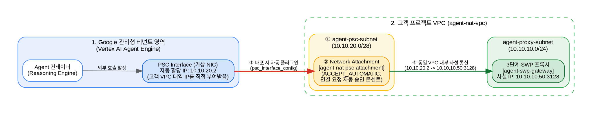

외부 데이터센터(온프레미스 레거시 시스템, 사내 DB, 프라이빗 API 서버 등)의 방화벽에서 특정 고정 공용 IP(Static Public IP)만 인바운드로 허용(Allowlist/화이트리스트)하도록 통제하는 경우, **Google-managed 테넌트의 기본 인터넷 Egress 대신 고객 VPC를 경유하는 Egress 아키텍처**를 구성해야 합니다.

---

### 1. 기본 구조에서 발생하는 문제와 해결 원리

* **기본 직접 Egress 사용 시 문제점**:
  * Agent Platform(또는 Agent Engine)의 기본 인터넷 Egress는 Google 내부 테넌트 풀의 공용 IP 대역을 동적으로 공유하여 나갑니다.
  * 이 대역은 IP가 유동적이고 Google Cloud 전체 사용자 대역과 겹치므로 데이터센터 방화벽에 단일 고정 IP로 등록할 수 없습니다.
* **해결 원리**:
  * 에이전트의 Egress 트래픽을 **PSC Interface (Private Service Connect Interface)**를 통해 고객사 VPC로 인입시킵니다.
  * 고객사 VPC 내부에 **프록시(Proxy) 또는 게이트웨이**를 배치하고, 외부로 나가는 길목에 **Cloud NAT (Manual IP Allocation)**을 연결하여 **사전에 예약해 둔 고정 외부 IP(Static External IP)**로 SNAT(Source Network Address Translation) 처리합니다.
  * 데이터센터 방화벽에는 이 예약된 Cloud NAT의 고정 공용 IP만 등록하면 됩니다.

---

### 2. 네트워크 흐름 다이어그램

```dot
digraph FixedIpEgress {
  rankdir=LR;
  graph [fontname="Google Sans, Arial", fontsize=10];
  node [fontname="Google Sans, Arial", fontsize=9, shape=box, style="rounded,filled", fillcolor="#f8f9fa", color="#bdc1c6"];
  edge [fontname="Google Sans, Arial", fontsize=8, color="#5f6368"];

  subgraph cluster_tenant {
    label="Google-Managed Tenant";
    style="filled";
    fillcolor="#f1f3f4";
    Agent [label="Agent Platform Runtime\n(Agent Engine / CES)", fillcolor="#d2e3fc"];
    PSCI [label="PSC Interface\n(eth1)", fillcolor="#fedfc8"];
  }

  subgraph cluster_customer_vpc {
    label="Customer VPC (GCP Project)";
    style="dashed";
    color="#34a853";
    NetAttach [label="Network Attachment\n(Subnet: 10.10.20.0/28)", fillcolor="#fedfc8"];
    ProxyVM [label="Forward Proxy / SWP VM\n(Squid / Envoy / SWP)\nInternal IP: 10.10.10.x", fillcolor="#e6f4ea"];
    CloudNAT [label="Cloud Router + Cloud NAT\n(수동 할당된 고정 공용 IP)\n예: 34.64.x.y", fillcolor="#ceead6"];
  }

  subgraph cluster_onprem {
    label="On-Premises / Remote Data Center";
    style="dashed";
    color="#ea4335";
    FW [label="DC 방화벽 (Firewall)\n[화이트리스트 등록: 34.64.x.y]", fillcolor="#fce8e6"];
    TargetAPI [label="내부 API 서버 / DB\n(Public IP 노출 서비스)", fillcolor="#fce8e6"];
  }

  Agent -> PSCI [label="도구/API 호출"];
  PSCI -> NetAttach [label="PSC 터널"];
  NetAttach -> ProxyVM [label="VPC 라우팅"];
  ProxyVM -> CloudNAT [label="인터넷 Egress 라우팅"];
  CloudNAT -> FW [label="고정 소스 IP (34.64.x.y)"];
  FW -> TargetAPI [label="허용 및 전달"];
}
```



---

### 3. 단계별 구축 방법

#### 0단계: 에이전트 NAT 전용 VPC(`agent-nat-vpc`) 및 프록시 서브넷(`agent-proxy-subnet`) 생성
기존에 사용 중인 VPC가 없다면 아래 명령어로 에이전트 외부 통신을 위한 커스텀 VPC(`agent-nat-vpc`)와 프록시를 배치할 기본 사설 서브넷(`agent-proxy-subnet`)을 먼저 생성합니다.

> **💡 참고**: 프로젝트 내 기존 VPC 목록을 먼저 확인하려면 `gcloud compute networks list` 명령어를 실행하세요. 만약 기존 VPC(예: `vertexai-network`)를 그대로 사용하려면 이후 단계의 `--network=agent-nat-vpc`를 `--network=vertexai-network`로 변경하여 실행하면 됩니다.

```bash
# 1. 기존 VPC 네트워크 목록 확인
gcloud compute networks list

# 2. 에이전트 NAT 전용 VPC 네트워크(agent-nat-vpc) 생성 (커스텀 서브넷 모드)
gcloud compute networks create agent-nat-vpc \
    --subnet-mode=custom

# 3. 프록시 배치 및 Cloud NAT 대상이 될 서브넷(agent-proxy-subnet) 생성
gcloud compute networks subnets create agent-proxy-subnet \
    --network=agent-nat-vpc \
    --region=asia-northeast3 \
    --range=10.10.10.0/24
```

#### 1단계: 고정 외부 IP 주소 예약 (Static External IP)
Cloud NAT 게이트웨이에 바인딩할 리전 단위 고정 IP를 예약합니다.

> **⚠️ 주의**: 동일한 리전 내에 기존 이름(`agent-nat-static-ip`)과 중복되는 IP 리소스가 있으면 생성 시 오류(`already exists`)가 발생합니다. 생성 전 아래 명령어로 기존에 생성된 IP가 있는지 먼저 확인하세요.

* **이미 생성된 IP 정보 확인하기**
  아래 명령어로 기존에 생성된 IP 주소 목록 또는 특정 IP의 상태(`RESERVED` 또는 `IN_USE`)를 확인할 수 있습니다.
  ```bash
  # 리전 내 전체 고정 IP 목록 확인
  gcloud compute addresses list --regions=asia-northeast3

  # 특정 고정 IP 상세 정보 및 상태(RESERVED / IN_USE) 확인
  gcloud compute addresses describe agent-nat-static-ip --region=asia-northeast3
  ```

* **신규 고정 외부 IP 생성하기** (기존 IP가 없거나 추가 생성이 필요한 경우 중복되지 않는 이름으로 생성)
  ```bash
  # 리전별 정적 외부 IP 생성
  gcloud compute addresses create agent-nat-static-ip-2 \
      --region=asia-northeast3
  ```

#### 2단계: Cloud Router 및 SWP 전용 Cloud NAT (Manual Allocation) 구성
자동 IP 할당(`--auto-allocate-nat-external-ips`) 대신 **수동 IP 할당 모드**를 지정하여 방금 예약한 고정 IP(`RESERVED` 상태인 `agent-nat-static-ip-2`)를 등록합니다.

> **⚠️ 핵심 주의 (`--endpoint-types=ENDPOINT_TYPE_SWG`)**:
> Cloud NAT의 기본 엔드포인트 타입은 일반 VM용(`ENDPOINT_TYPE_VM`)입니다. **Secure Web Proxy(SWP)**에서 나가는 트래픽을 고정 IP로 SNAT 처리하려면 반드시 **`--endpoint-types=ENDPOINT_TYPE_SWG`** 옵션을 명시해야 합니다.

```bash
# 1. 기존 Cloud Router 목록 확인
gcloud compute routers list --regions=asia-northeast3

# 2. 에이전트 NAT 전용 Cloud Router(agent-nat-router) 생성
gcloud compute routers create agent-nat-router \
    --network=agent-nat-vpc \
    --region=asia-northeast3

# 3. SWP 전용 Cloud NAT(agent-nat-gateway) 생성 및 고정 IP(agent-nat-static-ip-2) 바인딩
gcloud compute routers nats create agent-nat-gateway \
    --router=agent-nat-router \
    --region=asia-northeast3 \
    --endpoint-types=ENDPOINT_TYPE_SWG \
    --nat-all-subnet-ip-ranges \
    --nat-external-ip-pool=agent-nat-static-ip-2

# 4. 생성된 Cloud NAT 목록 확인 (ENDPOINT_TYPE_SWG 확인)
gcloud compute routers nats list \
    --router=agent-nat-router \
    --region=asia-northeast3
```

#### 3단계: 고객 VPC에 프록시(Forward Proxy) 구성 - Google Cloud Secure Web Proxy (SWP 무인증서 모드)
에이전트가 PSC Interface를 통해 도구 호출을 수행할 때, 공용 인터넷 목적지 도메인(`https://api.datacenter.com`)을 안전하게 처리할 완전 관리형 **Google Cloud Secure Web Proxy (SWP)**를 VPC 서브넷(`agent-proxy-subnet`)에 배치합니다.

> **💡 핵심 포인트 (TLS 인증서 없이 SWP 배포하기)**:
> SWP 게이트웨이 YAML 작성 시 불필요한 `scope` 필드와 `certificateUrls` 필드를 제외하고 `routingMode: EXPLICIT_ROUTING_MODE`로 지정하면, **별도의 TLS 인증서 생성/등록 없이도 표준 HTTP 프록시(`http://10.10.10.50:3128`)로 즉시 배포**할 수 있습니다.

##### 📊 Secure Web Proxy (SWP) 특징 및 장점

| 구분 | 내용 |
| :--- | :--- |
| **추천 용도** | **실제 상용 운영 (Production) 및 엔터프라이즈 환경 표준** |
| **장점 (Pros)** | • **완전 관리형(Serverless)**: 구글이 고가용성(HA)과 오토스케일링을 자동으로 보장 (단일 VM 장애 위험 없음)<br>• **TLS 인증서 관리 불필요**: `scope` 및 `certificateUrls`를 생략하여 사설 인증서 발급/갱신 부담 없이 즉시 `http://10.10.10.50:3128`로 구성 가능<br>• **세밀한 보안 통제**: 오픈 프록시 위험 없이 도메인(SNI/Host) 기반 정책(`GatewaySecurityPolicy`)으로 안전하게 제어 |
| **단점 (Cons)** | • 시간당 게이트웨이 기본 비용 및 트래픽 처리 비용 발생 |

---

##### 🔹 단계별 가이드: Google Cloud Secure Web Proxy (SWP) 무인증서 구성

0. **필수 GCP API 2종 활성화 (최초 1회)**
   SWP 게이트웨이와 보안 정책 관리를 위해 필요한 API를 활성화합니다.
   ```bash
   gcloud services enable \
       networkservices.googleapis.com \
       networksecurity.googleapis.com
   ```

1. **프록시 전용 서브넷(`agent-swp-subnet`, `REGIONAL_MANAGED_PROXY`) 생성**
   SWP(Secure Web Proxy)가 내부적으로 사용할 리전 프록시 전용 서브넷(최소 `/26` 이상 권장, 여기서는 `/24`)을 생성하고 확인합니다.
   ```bash
   # 프록시 전용 서브넷 생성
   gcloud compute networks subnets create agent-swp-subnet \
       --network=agent-nat-vpc \
       --region=asia-northeast3 \
       --range=10.10.30.0/24 \
       --purpose=REGIONAL_MANAGED_PROXY \
       --role=ACTIVE

   # 생성된 서브넷 목록 확인 (agent-proxy-subnet, agent-swp-subnet 확인)
   gcloud compute networks subnets list \
       --network=agent-nat-vpc \
       --regions=asia-northeast3
   ```

2. **Gateway 보안 정책(`agent-swp-policy`) 및 허용 규칙(`allow-datacenter-api`) 생성**
   `gateway-security-policies import` 명령어를 사용하여 보안 정책과 도메인 허용 규칙을 생성합니다.
   ```bash
   export PROJECT_ID=$(gcloud config get-value project)

   # 1. 보안 정책(agent-swp-policy) 생성
   gcloud network-security gateway-security-policies import agent-swp-policy \
       --location=asia-northeast3 \
       --source=- <<EOF
   name: projects/${PROJECT_ID}/locations/asia-northeast3/gatewaySecurityPolicies/agent-swp-policy
   description: Agent SWP Security Policy
   EOF

   # 2-A. [테스트/검증용 기본] 외부 호스트 호출 허용 규칙 생성
   gcloud network-security gateway-security-policies rules import allow-datacenter-api \
       --gateway-security-policy=agent-swp-policy \
       --location=asia-northeast3 \
       --source=- <<EOF
   name: projects/${PROJECT_ID}/locations/asia-northeast3/gatewaySecurityPolicies/agent-swp-policy/rules/allow-datacenter-api
   basicProfile: ALLOW
   enabled: true
   priority: 100
   sessionMatcher: "host() != ''"
   EOF

   # 2-B. [실무 운영 참고] 특정 데이터센터 도메인만 허용하려면 sessionMatcher를 아래와 같이 지정합니다:
   # sessionMatcher: "host() == 'api.datacenter.com' || host() == 'api.ipify.org'"

   # 3. 생성된 보안 정책 및 규칙 목록 확인
   gcloud network-security gateway-security-policies list --location=asia-northeast3
   gcloud network-security gateway-security-policies rules list \
       --gateway-security-policy=agent-swp-policy \
       --location=asia-northeast3
   ```

3. **Secure Web Proxy 게이트웨이(`agent-swp-gateway`) 무인증서 배포 (`EXPLICIT_ROUTING_MODE`)**
   `scope`와 `certificateUrls`를 제외하고 `routingMode: EXPLICIT_ROUTING_MODE`를 지정하여 사설 IP(`10.10.10.50`)와 포트(`3128`)로 SWP 인스턴스를 배포합니다.
   ```bash
   export PROJECT_ID=$(gcloud config get-value project)

   # SWP 게이트웨이 배포 (인증서 없이 배포, 약 30초 소요)
   gcloud network-services gateways import agent-swp-gateway \
       --location=asia-northeast3 \
       --source=- <<EOF
   name: projects/${PROJECT_ID}/locations/asia-northeast3/gateways/agent-swp-gateway
   type: SECURE_WEB_GATEWAY
   addresses: ["10.10.10.50"]
   ports: [3128]
   routingMode: EXPLICIT_ROUTING_MODE
   gatewaySecurityPolicy: projects/${PROJECT_ID}/locations/asia-northeast3/gatewaySecurityPolicies/agent-swp-policy
   network: projects/${PROJECT_ID}/global/networks/agent-nat-vpc
   subnetwork: projects/${PROJECT_ID}/regions/asia-northeast3/subnetworks/agent-proxy-subnet
   EOF

   # 배포된 SWP 게이트웨이 목록 및 상태 확인
   gcloud network-services gateways list --location=asia-northeast3
   ```

#### 4단계: PSC Interface (Network Attachment) 연결
에이전트(Google 관리형 테넌트 프로젝트에서 실행됨)가 고객 VPC(`agent-nat-vpc`) 내부로 직접 들어올 수 있도록 **"가상 랜선 콘센트"** 역할을 하는 전용 서브넷(`agent-psc-subnet`)과 **Network Attachment(`agent-nat-psc-attachment`)**를 생성합니다.

##### 🗺️ 4단계 동작 구조 다이어그램 (PSC Interface 연결 원리)



* **핵심 역할 요약**:
  1. **`agent-psc-subnet` (`10.10.20.0/28`)**: 구글 관리형 영역에 있는 에이전트에게 빌려줄 사설 IP 묶음(풀)입니다.
  2. **`agent-nat-psc-attachment` (`Network Attachment`)**: 에이전트가 우리 VPC(`agent-nat-vpc`)에 가상 랜선(NIC)을 꽂을 수 있게 해주는 **연결 포트(콘센트)**입니다. `--connection-preference=ACCEPT_AUTOMATIC`으로 설정하여 에이전트 배포 시 별도 수동 승인 없이 즉시 연결됩니다.
  3. **연결 후 효과**: 에이전트가 `10.10.20.x` IP를 달고 우리 VPC 내부 일원처럼 동작하므로, 3단계에서 만든 **`agent-swp-gateway` (`http://10.10.10.50:3128`)**와 내부 사설망으로 직접 통신할 수 있게 됩니다.

```bash
# 1. PSC Interface 전용 서브넷(agent-psc-subnet) 생성
gcloud compute networks subnets create agent-psc-subnet \
    --network=agent-nat-vpc \
    --region=asia-northeast3 \
    --range=10.10.20.0/28

# 2. Network Attachment(agent-nat-psc-attachment) 생성
gcloud compute network-attachments create agent-nat-psc-attachment \
    --region=asia-northeast3 \
    --subnets=agent-psc-subnet \
    --connection-preference=ACCEPT_AUTOMATIC

# 3. 생성된 Network Attachment 확인
gcloud compute network-attachments list --regions=asia-northeast3
```

---

#### 5단계: 데이터센터 방화벽 화이트리스트 등록 및 고정 IP(`api.ipify.org`) 검증

실제 고객사 환경에서는 1단계에서 예약한 고정 외부 IP(`agent-nat-static-ip-2`: **`34.64.196.163`**)를 데이터센터 인바운드 방화벽(WAF/보안장비)에 **Source IP**로 허용 등록합니다.

별도의 데이터센터 서버가 없는 테스트 환경에서는, 요청자의 공인 IP를 그대로 반환해 주는 공개 API(**`https://api.ipify.org?format=json`**)를 호출하는 에이전트를 배포하여 **에이전트의 외부 진출(Egress) IP가 정확히 `34.64.196.163`으로 찍히는지 검증**합니다.

##### 5-1. 예약된 고정 공인 IP 확인 및 IAM 권한 부여 (최초 1회)
Vertex AI Reasoning Engine 서비스 에이전트가 `agent-nat-psc-attachment`에 네트워크 인터페이스를 연결할 수 있도록 `compute.networkAdmin` 권한을 부여합니다.

```bash
export PROJECT_ID=$(gcloud config get-value project)
export PROJECT_NUMBER=$(gcloud projects describe $PROJECT_ID --format="value(projectNumber)")
export REGION="asia-northeast3"

# 1. 우리가 예약한 고정 공인 IP(34.64.196.163) 확인
export STATIC_NAT_IP=$(gcloud compute addresses describe agent-nat-static-ip-2 \
    --region=$REGION \
    --project=$PROJECT_ID \
    --format="value(address)")
echo "데이터센터 방화벽에 등록할 고정 공인 IP: $STATIC_NAT_IP"

# 2. Vertex AI Reasoning Engine 서비스 에이전트에 네트워크 권한 부여
gcloud projects add-iam-policy-binding $PROJECT_ID \
    --member="serviceAccount:service-${PROJECT_NUMBER}@gcp-sa-aiplatform-re.iam.gserviceaccount.com" \
    --role="roles/compute.networkAdmin"
```

##### 5-2. 고정 IP 확인용 에이전트 배포 및 `api.ipify.org` 호출 검증
4단계에서 만든 `agent-nat-psc-attachment`와 3단계에서 만든 SWP 프록시(`http://10.10.10.50:3128`)를 경유하여 외부 `https://api.ipify.org?format=json`을 호출하는 에이전트를 배포하고 결과를 확인합니다.

```python
import urllib.request
import vertexai
from vertexai.preview import reasoning_engines

PROJECT_ID = "gemeni-workshop"
LOCATION = "asia-northeast3"
STAGING_BUCKET = "gs://run-sources-gemeni-workshop-asia-northeast3"
NETWORK_ATTACHMENT = f"projects/{PROJECT_ID}/regions/{LOCATION}/networkAttachments/agent-nat-psc-attachment"
SWP_PROXY_URL = "http://10.10.10.50:3128"

vertexai.init(project=PROJECT_ID, location=LOCATION, staging_bucket=STAGING_BUCKET)

class NatEgressTestAgent:
    def query(self, question: str = "check") -> dict:
        proxy_handler = urllib.request.ProxyHandler({
            "http": SWP_PROXY_URL,
            "https": SWP_PROXY_URL,
        })
        opener = urllib.request.build_opener(proxy_handler)
        with opener.open("https://api.ipify.org?format=json", timeout=10) as response:
            ip_data = response.read().decode("utf-8")
        return {
            "question": question,
            "swp_proxy_used": SWP_PROXY_URL,
            "detected_egress_public_ip": ip_data,
        }

# 1. PSC Interface(agent-nat-psc-attachment)를 연결하여 에이전트 배포
remote_agent = reasoning_engines.ReasoningEngine.create(
    NatEgressTestAgent(),
    display_name="agent-nat-swp-verify-agent",
    description="Agent Engine Egress Fixed IP Verification via SWP and Cloud NAT",
    psc_interface_config={
        "network_attachment": NETWORK_ATTACHMENT,
    },
)

print("배포 완료 리소스명:", remote_agent.resource_name)

# 2. 배포된 에이전트 호출 테스트 (detected_egress_public_ip가 34.64.196.163과 일치하는지 확인)
result = remote_agent.query(question="현재 에이전트가 외부로 나가는 공인 IP가 무엇인가요?")
print("검증 결과:", result)
```

* **정상 검증 결과 예시**:
  ```json
  {
    "question": "현재 에이전트가 외부로 나가는 공인 IP가 무엇인가요?",
    "swp_proxy_used": "http://10.10.10.50:3128",
    "detected_egress_public_ip": "{\"ip\":\"34.64.196.163\"}"
  }
  ```
  `detected_egress_public_ip` 값이 `agent-nat-static-ip-2`의 IP인 **`34.64.196.163`**으로 출력되면 전체 구간(`Agent Engine` $\rightarrow$ `PSC Interface` $\rightarrow$ `SWP` $\rightarrow$ `Cloud NAT 고정 IP`)이 완벽하게 동작하는 것입니다.

---

### 4. 대안: 전용선/VPN을 통한 사설망(Private) 연동 (권장 검토)

만약 데이터센터가 이미 GCP와 **Cloud Interconnect(전용선)** 또는 **Cloud VPN**으로 연결되어 있다면, 트래픽을 굳이 공용 인터넷으로 돌리지 않고 **내부 사설 IP로 직접 통신**하는 것이 보안 및 지연시간 측면에서 훨씬 유리합니다.

* **동작 방식**: 
  $$\text{Agent Platform} \xrightarrow{\text{PSC-I}} \text{고객 VPC} \xrightarrow{\text{Cloud Router (BGP)}} \xrightarrow{\text{VPN / Interconnect}} \text{데이터센터 사설망}$$
* **장점**: 공용 인터넷 구간을 타지 않으므로 데이터 암호화 터널 내부에서만 안전하게 흐르며, 공용 IP 노출이나 디도스 위험 없이 데이터센터 내부 방화벽의 사설 IP 대역 허용만으로 해결됩니다.

---

### 5. 핵심 요약
1. **가능 여부**: 완벽하게 가능합니다.
2. **핵심 방식**: **PSC Interface (`agent-nat-psc-attachment`)**로 Agent 트래픽을 고객 VPC(`agent-nat-vpc`)로 유입 $\rightarrow$ **Secure Web Proxy (`10.10.10.50:3128`)** 경유 $\rightarrow$ **Cloud NAT (수동 할당 모드)**를 통해 사전에 확보한 **고정 공용 IP (`34.64.196.163`)**로 변환되어 데이터센터로 전송됩니다.
3. **작업 포인트**: GCP 측에서 예약한 리전 고정 IP 주소를 데이터센터 네트워크 보안팀에 전달하여 인바운드 ACL(화이트리스트)에 등록하시면 됩니다.